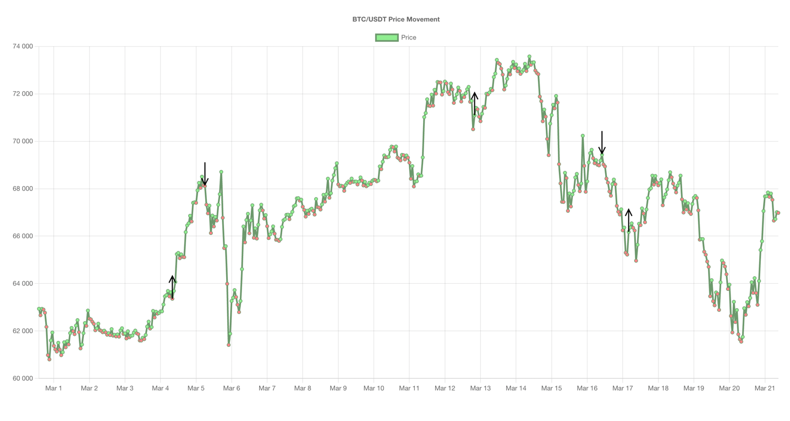

# BTC SMA Crossover Chart

[](https://github.com/dianaasamkova/candlestick-chart-app/actions/workflows/ci.yml)
[](https://www.npmjs.com/package/candlestick-app-chart)

A React chart component that plots the last 30 days of BTC/USDT prices from Binance and marks **buy/sell signals** where the 20-hour simple moving average crosses the 60-hour one. It's published to npm and comes with an example app that consumes it.



<sub>Captured in March 2024, before the 2026 signal-timing fix: the arrows shown here come from the old, misaligned calculation.</sub>

> **Context:** a 2024 exercise in shipping a reusable React component as an npm package. In 2026 I found and fixed a bug that shifted every signal, fixed the package manifest, and documented the design. See [TECH.md](TECH.md).

## Highlights

- **Published library.** It's on npm as [`candlestick-app-chart`](https://www.npmjs.com/package/candlestick-app-chart), bundled with Rollup into **CJS + ESM** with a single rolled-up `types.d.ts`.
- **Library and consumer kept separate.** `lib/` is the package; `app/` installs it from npm like any other project would.
- **Trading logic as pure functions.** `calculateSMA` and `generateSignals` are framework-free and unit-tested, including exact crossover timing.
- **Signals drawn on the chart** with `chartjs-plugin-annotation`, on a real time axis (`chartjs-adapter-date-fns`).
- **Up/down colouring** of each point relative to the previous close.

## Tech stack

React 18 · TypeScript · Chart.js 4 + react-chartjs-2 · chartjs-plugin-annotation · Rollup 4 · Jest

## Quick start

Requires Node 18+ and Yarn 1.

**Library: tests and build**

```bash
cd lib
yarn install
yarn test --watchAll=false
yarn build          # → dist/cjs, dist/esm, dist/types.d.ts
```

**Example app** (uses the published package)

```bash
cd app
yarn install
yarn start          # http://localhost:3000
```

**Use in your project**

```bash
npm install candlestick-app-chart
```

```tsx
import { CandlestickChart } from "candlestick-app-chart";

export default function Page() {
  return <CandlestickChart />;
}
```

> Binance blocks `api.binance.com` in some regions (e.g. HTTP 451 in the US). See the roadmap in TECH.md.

## Repository layout

```
lib/                        # npm package
├── src/components/Chart/   # CandlestickChart: fetch, signals, Chart.js render
├── src/utils/handler.ts    # calculateSMA, generateSignals (pure)
├── src/utils/handlers.spec.ts
└── rollup.config.js        # CJS + ESM + d.ts bundles; React stays external
app/                        # Example consumer (Create React App)
```

## Docs

- [TECH.md](TECH.md): architecture, the signal algorithm, packaging decisions, the 2026 bug fix, and a roadmap.
