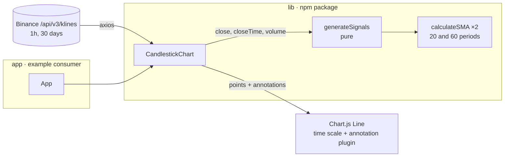

# BTC SMA Crossover Chart: Technical Notes

## 1. Problem

Give traders a quick visual answer to *"when did the short-term trend turn?"*. Plot recent BTC/USDT prices and mark the moments where a fast moving average crosses a slow one. Ship it as a reusable React component that other apps install from npm.

**Acceptance criteria**

- Hourly prices for the last 30 days load from the Binance public API.
- The chart shows price over a real time axis.
- A **buy** is marked where SMA(20) crosses **above** SMA(60); a **sell** where it crosses **below**.
- The component is installable from npm and works in a separate React app.

## 2. Architecture

### Signal algorithm

1. `calculateSMA(data, n)` returns one average per complete window, so `sma[k]` covers candles `k … k+n-1`.
2. For each candle `i` that has a long SMA (and so does `i-1`), compare SMA20 and SMA60 **at the same candle**.
3. If short ≤ long at `i-1` and short > long at `i`, it's a **buy**. The mirror case is a **sell**.

### Bug fixed in 2026

`generateSignals` read both SMA arrays with the candle index `i`. Because each array starts at `period - 1`, it compared a 20-period average ending at candle `i+19` with a 60-period average ending at candle `i+59`. Signals came out shifted, or not at all: a clean step from 100 to 200 produced **no** signal. Each array is now read at its own offset. Tests pin the exact crossover candle for a buy and for a sell, and check that there's no signal before 60 candles exist.

## 3. Key decisions

| Decision | Why | Trade-off |
|---|---|---|
| Chart.js via `react-chartjs-2` | Mature, canvas-based, has a time scale and an annotation plugin | Not a true candlestick: it plots closes as a line. OHLC needs `chartjs-chart-financial` |
| SMA crossover (20/60 on 1h) | Simple and well known; easy to explain and to test | Lags the market and gives false signals in sideways markets |
| Pure functions for the maths | Unit-testable without React or the network | — |
| Rollup with CJS + ESM + one `.d.ts` | Works in old (CommonJS) and modern (ESM, tree-shaking) bundlers, with types | Build config to maintain |
| React as a **peer** dependency (2026) | One React instance in the host app; no duplicate-hooks errors | Consumers must provide React ≥ 17 |
| Separate `app/` that installs from npm | Proves the published artifact works, not just the source | Tests the last *published* version, not local changes |

### Packaging fixes in 2026

- `react` and `react-dom` moved to `peerDependencies`; `react/jsx-runtime` is now external too. The ESM bundle went from 279 KB to 266 KB.
- `react-scripts` (all of Create React App) removed from runtime `dependencies`, so consumers no longer install it.
- Removed the Create React App `start`/`build`/`eject` scripts, which couldn't work in a library; `yarn build` now runs the Rollup build.
- These changes need a new npm release (e.g. `0.1.0`) to reach consumers.

## 4. Quality

- **Tests:** SMA values; crossover timing for buy and sell; no signals when there's too little data.
- **CI:** GitHub Actions runs the library tests and the Rollup build on every push and pull request.

## 5. Looking back (2026)

- **Make the component data-driven.** It fetches inside itself, with the symbol, interval and periods hard-coded. I'd split it into a `useKlines({ symbol, interval })` hook and a presentational `<SignalChart data periods />`, so the host app controls data, caching and errors.
- **Loading and empty states.** Right now there's only an error message.
- **Arrow length** is a fixed `+1000` price units, which breaks for any asset not priced like BTC. It should scale with the visible price range.
- **Name.** It's a line chart with signals, not a candlestick chart; the package name should say so.
- **API region.** Use `data-api.binance.vision` (public market data) or let the host app pass a base URL, because `api.binance.com` is blocked in some regions.
- **Workspace.** A Yarn/npm workspace would let `app/` build against local `lib/` sources.

## 6. Roadmap

1. Real candlesticks (OHLC) with `chartjs-chart-financial`, plus a volume subplot.
2. Props for symbol, interval, SMA periods and theme; publish `0.1.0` with the packaging fixes.
3. Live updates via the Binance WebSocket kline stream.
4. A signal list next to the chart, with hover to highlight it.
5. Backtest summary: return of the strategy versus buy-and-hold over the window.
